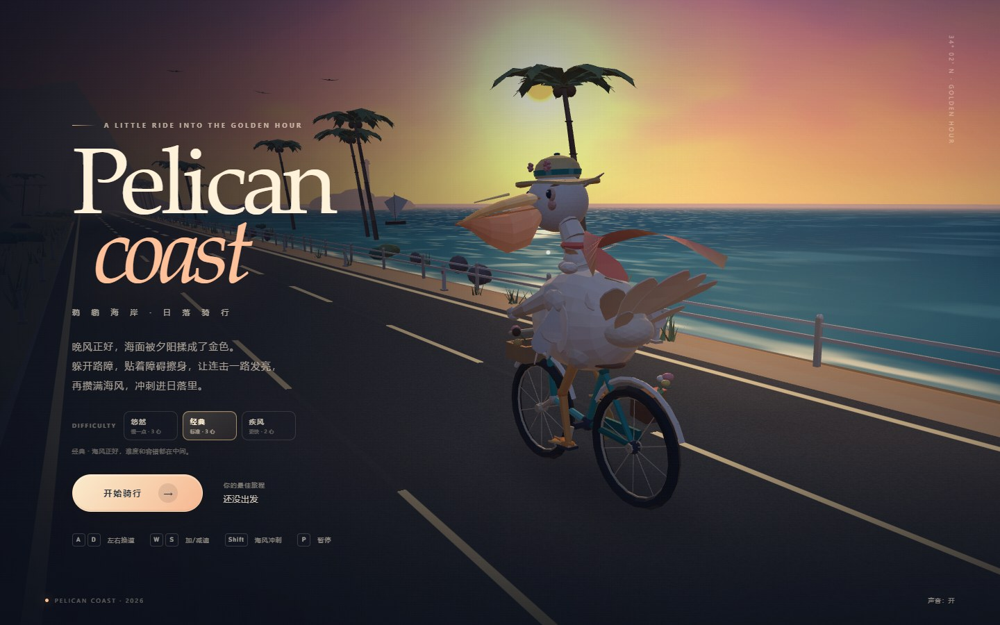
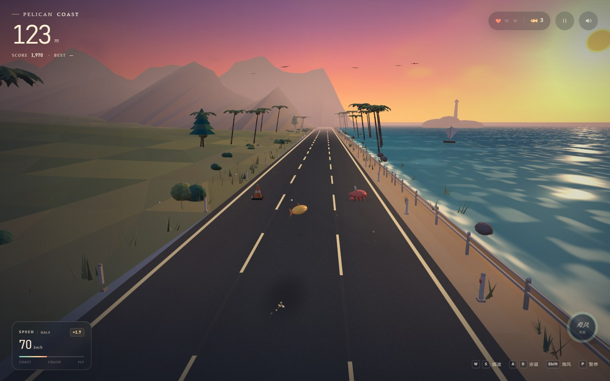
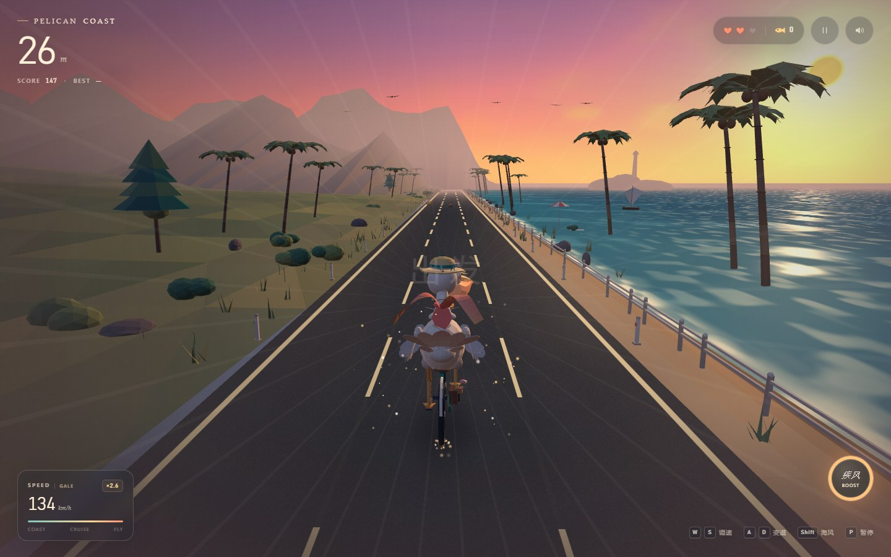

# Pelican Coast

### One HTML file. Zero dependencies. A 3D game built to test DeepSeek-V4.1-flash1017.

> On the surface, it is a pelican riding a bicycle into a golden-hour coastline.  
> Under the hood, it is a **256 KB, zero-dependency, single-file capability test** — built, shipped, and tested in a real browser.  
> v2.0 is still strictly single-player: no online, no accounts, no leaderboard servers. Just a deeper game.

[简体中文](README.md) · **English** · [GitHub repository](https://github.com/xsw77492-code/Pelican-Coast-v1.1-a-3D-game-benchmark-for-DeepSeek-V4.1-flash1017)

<p align="center">
  
  
  
  
  
  
</p>



## Why this exists

In October 2026, we put the new **DeepSeek-V4.1-flash1017** through a deliberately unforgiving test:

> “Make a small HTML game about a pelican riding a bicycle. It can be 3D. Let the player control speed and dodge obstacles.  
> The animation and interface must be beautiful. The algorithms must be accurate.”

There was one extra rule:

**No Three.js. No game engine. No external images, audio, or font files. Everything in one HTML file.**

We were not testing whether the model could produce a plausible-looking demo. We were testing whether it could deliver **creative direction, 3D graphics, collision math, procedural art, game feel, UI, audio, responsive design, and engineering polish** in one pass.

This is the result: a straw-hatted pelican with a silk scarf, riding a teal bicycle through a low-poly sunset.

**Vibe-coded. Then tested like it wasn't.**

> [!NOTE]
> This is an independent evaluation project, not an official DeepSeek project. The model name follows this run's evaluation configuration.

## The 30-second version

| | |
| --- | --- |
| Artifact | One `index.html`, about **256 KB**, zero runtime dependencies |
| Rendering | **Native WebGL2** with a hand-written math, shader, mesh, and particle stack |
| Gameplay | Three difficulties, wind boost, golden fish, moving crabs, combos, near misses, ranking |
| Visuals | Procedural sunset coast, pelican rider, animated silk scarf, ocean, palms, lighthouse |
| Platforms | Keyboard on desktop, touch controls on mobile, fully offline; strictly single-player |
| Model | **DeepSeek-V4.1-flash1017** (this run) |
| Verified | Stable ~60 FPS · 0 console errors · **37 obstacle rows, 0 fairness failures** · mobile pass |

## Play it

**Local:** download or clone the repo, then open [`index.html`](index.html). No install, no build, no internet required.

Or serve the folder:

```bash
python -m http.server 8080
```

Then open <http://localhost:8080/>.

**GitHub Pages:** after pushing to GitHub, go to `Settings → Pages → Deploy from a branch`, choose `main` and `/ (root)`, then play at:

```text
https://xsw77492-code.github.io/Pelican-Coast-v1.1-a-3D-game-benchmark-for-DeepSeek-V4.1-flash1017/
```

Once GitHub Pages is enabled, the game is playable there.

> [!TIP]
> Chrome or Edge with WebGL2 enabled gives the best experience.

## Controls

| Action | Keyboard |
| --- | --- |
| Accelerate | `W` / `↑` |
| Brake / slow down | `S` / `↓` / `Space` |
| Change lane | `A` `D` / `←` `→` |
| Wind boost | `Shift` |
| Pause / resume | `P` / `Esc` |
| Mute | `M` |
| Restart after game over | `R` / `Enter` |

Touch devices automatically get left/right lane buttons, `slow`, `go`, and a wind boost button. Choose **Cruise / Classic / Gale** before starting.

## Screenshots



<p align="center">
  
</p>

## What is in v2.0

- **Three difficulties**: Cruise / Classic / Gale, each with its own start speed, speed cap, hearts, obstacle density, and near-miss window.
- **Wind boost**: fish and near misses fill a wind meter. At full, press `Shift` or tap the wind button for a 3.2-second burst of speed and score — with no invincibility. A crash ends it.
- **Golden fish**: rare high-value pickups that grant extra score and wind, usually placed on a less obvious but safe route.
- **Moving crab**: scuttles sideways inside its blocked lane, with a readable model; the generator still guarantees a reachable safe line.
- **Per-mode best**: each difficulty stores its own best run; the HUD, title, and results show the active mode's record.
- **S / A / B / C rank**: results score distance, max combo, near misses, golden fish, boosts, and fish.
- **Complete loop**: title, difficulty select, countdown, play, pause, death, results, restart, local best.
- **Procedural coast**: animated ocean, sunset sky, palms, lighthouse, sailboats, birds, floating particles, boost trails.
- **Pelican v2**: longer S-curved neck, feather collar, rounded wings and tail fan, wide straw hat with flowers, silk scarf, blinking, a spread-wing boost pose, and rear bouquet.
- **Desktop and mobile**: the same single file adapts to both, with touch controls on coarse pointers.

### Difficulty tuning

| Mode | Hearts | Speed cap | Obstacle density | Near-miss window | For |
| --- | --- | --- | --- | --- | --- |
| Cruise | 3 | 26 m/s | Relaxed | 0.90 m | First rides and sightseeing |
| Classic | 3 | 31 m/s | Standard | 0.74 m | The intended experience |
| Gale | 2 | 36 m/s | Dense | 0.58 m | High-score attempts |

### Wind boost rules

- Fish +10 wind, golden fish +26, near miss +18
- At 100 wind, press `Shift` or tap the button
- Boost raises the speed cap by ~16% and multiplies score by ×1.35
- No invincibility. A collision ends the boost immediately
- The wind meter survives a combo break, so you can save it for a safer stretch

## Why this is a hard model test

The hard part is not drawing a pelican.

- **No library crutches**: no Three.js, no engine, no ready-made game template.
- **3D math**: camera, projection, lighting, normals, matrices, and swept collision are implemented from scratch.
- **Procedural art**: the coast, sky, pelican, bicycle, hat, scarf, and flowers are all code.
- **Algorithmic correctness**: the generator cannot create an obstacle row with no reachable safe line.
- **Complete state machine**: intro, countdown, play, pause, damage, death, results, restart, persistence.
- **Performance and responsiveness**: 60 FPS on desktop, playable at 375 px wide.
- **Taste**: consistent palette, composition, silhouette, and animation — the part that is hardest to grade automatically.
- **It has to actually run**: not just look like game code.

## Evaluation results

The full test log is in [EVALUATION.md](EVALUATION.md) (Chinese), with an English summary below.

| Check | Result |
| --- | --- |
| Delivery | Single file, zero runtime dependencies, zero external assets |
| Ready time | ~0.8 s |
| Gameplay FPS @ 1440×900 | **stable ~60 FPS** (first sample includes load warm-up) |
| Console errors | **0** |
| WebGL errors | **0** |
| Obstacle fairness | **37 rows, 0 unreachable safe lines** |
| Three difficulties: start / cap / hearts | Pass |
| Wind fill / Shift boost / collision interrupt | Pass |
| Golden fish spawn, pickup, reward | Pass |
| Moving crab spawn / safe lane | Pass |
| S / A / B / C rank | Pass |
| Per-mode best scores | Pass |
| Near-miss detection / score / VFX | Pass |
| Combo build / 4.5 s expiry / hit reset | Pass |
| Max combo in results | Pass |
| Collision → heart loss → death → results | Pass |
| Pause / resume / restart | Pass |
| Best score in `localStorage` | Pass |
| Mobile 390 / 375 layouts | Pass, no horizontal overflow |
| Mobile touch lane change / boost | Pass |

Environment:

```text
Chrome + WebGL2
ANGLE / Direct3D 11
Intel UHD Graphics
1440 × 900 / stable ~60 FPS
```

## v1.0 → v1.1 → v2.0

This project was not a one-shot demo that was abandoned after generation.

- **v1.0** delivered the coast, the rider, the game loop, the UI, audio, and mobile support.
- **v1.1** added combo and near-miss gameplay, rebuilt the pelican, and added a browser regression pass.
- **v2.0** added three difficulties, wind boost, golden fish, a moving crab, per-mode bests, and S/A/B/C ranking; the pelican gained rounded feathers, blinking, and a boost pose.

That iteration matters for a model evaluation: it tests not only first-pass generation, but whether the model can revise a working artifact, preserve correctness, and improve the experience.

## Technical notes

<details>
<summary><strong>Open the engine notes</strong></summary>

- **Hand-written WebGL2 renderer**: matrix math, perspective projection, custom mesh builder, GLSL shaders, and a fixed render loop.
- **Procedural geometry**: the pelican, bicycle, obstacles, crab, palms, lighthouse, coastline, and fish are generated at boot.
- **Animated silk scarf**: a custom cloth mesh updated every frame, with motion driven by speed, steering, boost, and time.
- **Fixed 120 Hz simulation**: rendering and gameplay are decoupled. Even at low frame rates, movement does not tunnel through thin obstacles.
- **Swept collision**: each obstacle is tested against the rider using the Z interval swept during the step.
- **Fair obstacle generation**: at most two lanes are blocked per row; every safe lane from the previous row must be reachable with at most one lane change. The crab only sways inside its blocked lane.
- **Difficulty curves**: three explicit sets of speed, hearts, density, near-miss window, and crab timing — no hidden adaptive difficulty.
- **Wind system**: fish/near-miss charge, a timed speed burst, a separate score multiplier, and collision interruption.
- **Procedural audio**: ocean, wind, pickups, collisions, near misses, combo milestones, wind-ready, boost, countdown, and results are synthesized with WebAudio.
- **Responsive rendering**: capped device pixel ratio on small screens and a dedicated touch layer.
- **Local persistence**: best score and mute preference use `localStorage`.

</details>

## Reproduce the test with another model

If you want to compare coding models:

1. Give the model the same constraints: **one file, zero dependencies, zero external assets, complete game, beautiful animation, accurate collision and obstacle generation**.
2. Ask for a plan before implementation.
3. Open the result in a real browser — do not review code alone.
4. Run the fairness check: can every previous safe lane reach a safe lane in the next row?
5. Test collisions at both high and low frame rates, plus pause, death, restart, and mobile.
6. Record the outcome in [EVALUATION.md](EVALUATION.md) or submit a PR.

### Debug API

The page exposes a test-only object, `window.__pelicanCoast`:

```js
window.__pelicanCoast.getState();          // state, combo, wind, fairness
window.__pelicanCoast.setDifficulty("gale"); // Cruise / Classic / Gale
window.__pelicanCoast.start();
window.__pelicanCoast.skipCountdown();
window.__pelicanCoast.advance(5);          // fast-forward 5 seconds
window.__pelicanCoast.setWind(100);        // test a full wind meter
window.__pelicanCoast.boost();             // trigger wind boost
window.__pelicanCoast.setInvincible(999);  // tests / demos only
window.__pelicanCoast.moveLane(1);
window.__pelicanCoast.stageNearMiss();     // controlled near-miss scenario
window.__pelicanCoast.stageGoldenFish();   // controlled golden-fish pickup
window.__pelicanCoast.stageHazards();      // crab + golden fish showcase
window.__pelicanCoast.pause();
window.__pelicanCoast.resume();
```

This is not a stable public API; it exists for automated screenshots and gameplay verification.

## Roadmap

- **v2.1**: daily fixed single-player seed, 60-second sprint; still no online
- **v2.2**: more readable and dodgeable obstacle combinations, finer difficulty curves
- **Later**: ghost replays, more coastlines, multi-model comparison write-ups

## Contributing

Contributions are welcome:

- test another model and share the result
- improve gameplay, visuals, or performance
- report a bug or propose a cleaner implementation
- use the project as a reference for single-file games or coding-model evaluations

For pull requests, please try to preserve the **single-file, zero-dependency, offline-playable** nature of the project.

## License

[MIT](LICENSE) © 2026 xu-shiwei66

---

### ⭐ If this is useful

If you evaluate coding models, build single-file games, or just like a pelican on a bicycle, **a star helps more people discover this benchmark**.

**Tested with DeepSeek-V4.1-flash1017 · Built in DeepSeek Harness · Independent project, not affiliated with DeepSeek.**
